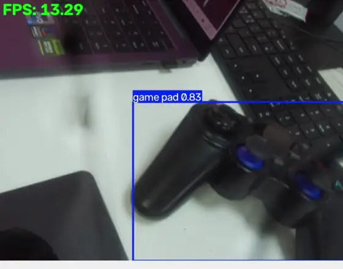

# Raspberry Pi YOLO Edge AI

Raspberry Pi 5 카메라로 직접 모은 사진에 라벨을 달고 YOLOv8n을 학습시킨 뒤, ONNX로 변환해 보드 위에서 실시간으로 게임패드를 찾는 엣지 AI 실습이다.

<p align="center">
  
</p>

<p align="center"><em>Raspberry Pi 5 카메라 영상에 학습한 모델로 추론한 결과 (녹화 영상 앞 10초)</em></p>

- 데이터: Raspberry Pi 5 카메라(Picamera2)로 찍은 게임패드 사진 100장, 클래스 1개(`game pad`)
- 학습: Roboflow에서 라벨링한 데이터로 YOLOv8n을 파인튜닝했다.
- 배포: 학습한 모델을 입력 224×224의 ONNX로 내보내고, Raspberry Pi 5에서 onnxruntime으로 카메라 영상에 추론했다.
- 과정 실습의 흐름을 따라간 작은 규모의 작업이라 정확도와 속도는 따로 측정하지 않았다. 범위는 [구현 범위](#구현-범위)에 정리했다.

| 항목 | 내용 |
|---|---|
| 과정 | SSAFY 16기 임베디드 트랙, 라즈베리파이와 AI |
| 인원 | 1명 |
| 사용 기술 | Python, Picamera2, Roboflow, YOLOv8n (Ultralytics), ONNX, Netron, onnxruntime |
| 실행 환경 | 학습: PC / 추론: Raspberry Pi 5 + 카메라 모듈 |

---

## 프로젝트 배경

### 엣지 AI
엣지 AI는 모델을 서버가 아니라 카메라나 센서가 붙어 있는 장치(엣지) 위에서 직접 실행하는 방식이다. 영상을 밖으로 보내지 않아도 되고 네트워크가 없어도 동작하지만, 장치의 연산 능력과 메모리가 작아서 모델을 가볍게 만들고 장치에서 실행할 수 있는 형식으로 바꿔야 한다.

그래서 보통 학습은 PC에서 하고, 학습이 끝난 모델을 ONNX 같은 공통 형식으로 내보낸 뒤 장치에서는 추론만 한다. 이 실습은 그 흐름을 데이터 수집부터 보드 위 추론까지 한 번에 따라가 본 것이다.

### 구현 범위

| 해 본 것 | 하지 않은 것 |
|---|---|
| Picamera2로 학습용 사진 수집 | 데이터 증강, 배경(객체 없는) 이미지 추가 |
| Roboflow 라벨링과 학습/검증/테스트 분할 | 정확도(mAP 등) 측정과 비교 |
| YOLOv8n 파인튜닝 | 보드 위 추론 속도 측정, 양자화(INT8) |
| ONNX 변환과 Netron으로 구조 확인 | 여러 클래스 인식 |
| Raspberry Pi 5에서 onnxruntime 실시간 추론 | |

---

## 1. 내가 한 일

1. 인식할 객체(게임패드)를 정하고, Raspberry Pi 5 카메라로 학습용 사진 100장을 찍었다.
2. Roboflow에서 `game pad` 클래스 하나로 바운딩 박스를 달고, 학습·검증·테스트 세트를 나눴다.
3. YOLOv8n을 이 데이터로 파인튜닝해 `best.pt`를 얻었다.
4. 학습한 모델을 입력 224×224의 ONNX(`best.onnx`)로 내보내고, Netron으로 입력과 출력 구조를 확인했다.
5. Raspberry Pi 5에서 onnxruntime으로 카메라 영상을 받아 실시간으로 게임패드를 찾고, 결과를 녹화했다.

---

## 2. 전체 흐름

```
[Raspberry Pi 5 카메라]
        │ Picamera2로 사진 100장 수집
        ▼
[Roboflow] 라벨링 (game pad) · 70/20/10 분할 · 512×512 리사이즈
        │ YOLOv8 형식으로 내보내기
        ▼
[PC] YOLOv8n 파인튜닝 → best.pt
        │ ONNX 변환 (입력 224×224) → best.onnx, Netron으로 구조 확인
        ▼
[Raspberry Pi 5] onnxruntime + 카메라 → 실시간 추론 화면
```

| 폴더 | 내용 |
|---|---|
| `dataset/` | Roboflow에서 내보낸 YOLOv8 형식 데이터셋 (`train` 70, `valid` 20, `test` 10장, `data.yaml`) |
| `models/` | 학습 결과 `best.pt`, 변환한 `best.onnx` |
| `results/` | Raspberry Pi 5 추론 결과 화면(`inference.jpg`)과 녹화 영상(`inference.mp4`) |
| `docs/images/` | README용 이미지 |

---

## 3. 단계별 내용

### 데이터 수집과 라벨링
- Raspberry Pi 5 카메라(Picamera2)로 게임패드 사진 100장을 모았다.
- Roboflow에서 `game pad` 클래스 하나로 바운딩 박스를 달았다.
- 학습·검증·테스트를 70/20/10장으로 나눴다.
- 전처리는 Roboflow 내보내기 설정 그대로다. EXIF 방향을 맞추고 512×512로 늘려 맞췄으며(stretch), 증강은 하지 않았다.

### 학습
- 사전 학습된 YOLOv8n을 이 데이터셋으로 파인튜닝했다. 가장 작은 YOLOv8 모델이라 Raspberry Pi 5에서 돌리기에 맞는 크기다.
- 학습 결과 가중치는 `models/best.pt`다.

### ONNX 변환
- PyTorch 모델은 그대로는 보드에서 실행하기 무겁고 PyTorch 설치가 필요하다. 그래서 공통 형식인 ONNX로 내보내 onnxruntime만으로 실행할 수 있게 했다.
- 입력 크기는 224×224로 정했다(`models/best.onnx`).
- Netron으로 ONNX 파일을 열어 입력과 출력 텐서의 모양을 확인했다. 보드에서 추론할 때 카메라 영상을 같은 크기로 맞춰 넣고 출력을 박스로 풀어야 하기 때문이다.

### 보드 위 추론
- Raspberry Pi 5에서 onnxruntime으로 `best.onnx`를 불러 카메라 영상을 프레임마다 추론했다.
- 찾은 게임패드는 `game pad` 박스와 신뢰도로, 화면 왼쪽 위에는 FPS를 표시했다.
- 추론에 쓴 코드는 남아 있지 않아 이 저장소에 포함하지 않았다. 남아 있는 결과물은 모델 파일과 추론 화면, 녹화 영상이다.

---

## 4. 결과

맨 위의 영상은 Raspberry Pi 5에서 카메라를 움직이며 14초 동안 추론한 영상의 앞 10초다. 전체 영상은 `results/inference.mp4`에 있다.

- 게임패드가 화면 가운데에 크게 잡히면 `game pad` 박스와 신뢰도가 표시된다.
- 게임패드가 화면 가장자리에 걸리거나 작게 보이는 장면에서는 박스가 뜨지 않은 경우가 많았다. 원인은 따로 실험해 확인하지 않았다.

### 확인하지 않은 것
- 테스트 세트에 대한 정확도(mAP, precision, recall)는 기록이 남아 있지 않아 적지 않았다.
- 화면의 FPS 값은 추론 화면에 표시된 값일 뿐, 같은 조건에서 반복 측정한 속도가 아니다.

---

## 5. 배운 점

1. 엣지 AI의 기본 흐름: 학습은 PC에서, 추론은 보드에서 하는 흐름을 데이터 수집부터 보드 위 추론까지 직접 따라가 봤다.
2. Roboflow를 활용한 데이터 전처리: 찍은 사진에 바운딩 박스로 라벨을 달고, 학습·검증·테스트 세트를 70/20/10으로 나누고, 이미지 크기를 512×512로 맞춘 뒤 YOLOv8 형식(`data.yaml`)으로 내보내는 과정을 해 보며, 학습 전에 데이터를 모델이 읽을 수 있는 형식으로 정리하는 방법을 알게 되었다. 증강(augmentation) 같은 다른 전처리 옵션은 이번에 써 보지 않았다.
3. 모델 형식 변환: 학습한 모델을 ONNX로 바꾸면 보드에서 PyTorch 없이 onnxruntime만으로 실행할 수 있다는 것, 그리고 내보낼 때 정한 입력 크기에 맞춰 영상을 넣어야 한다는 것을 Netron으로 구조를 보며 확인했다.
4. 결과를 보는 눈: 박스가 뜬 장면만 보면 잘 되는 것 같지만, 영상을 처음부터 끝까지 보니 게임패드가 가장자리에 있거나 작게 보일 때 놓치는 장면이 많았다. 다음에는 거리와 위치가 다양한 사진을 더하고, 바꾸기 전후를 같은 영상과 테스트 세트로 비교해 보고 싶다.

---

## 데이터셋 출처

`dataset/`은 직접 찍은 사진을 Roboflow에서 라벨링해 내보낸 것이다. Roboflow 내보내기 설정의 라이선스는 CC BY 4.0이다(`dataset/README.roboflow.txt`).
